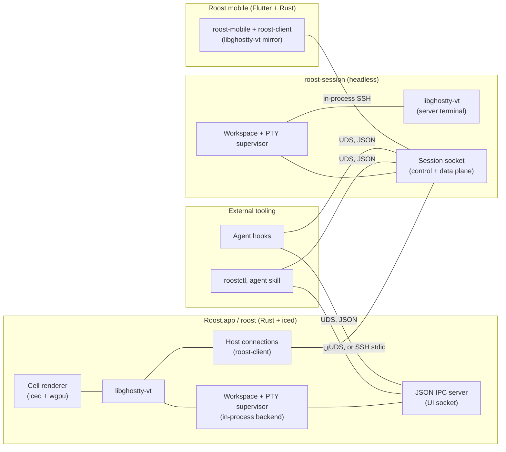

# Roost vision

Where Roost is going, the rules every change is measured against, and an
index of the decisions behind them. Updated 2026-11-08, after v0.1.0.

This page is short on purpose. The full text of every decision, and the
history of how Roost got its current shape, is in
[Decision history](decision-history.md). Depth on the code is in
[Architecture](../reference/architecture.md) and the pages under
[Related docs](#related-docs).

## What Roost is for {: #the-product }

Roost is the place to run and supervise coding agents across your
machines. You keep several agents busy at once, in several projects, on
the laptop in front of you and on the boxes you reach over SSH. Roost
tells you which one needs you, and lets you pick up any of them from any
screen, including a phone.

It stays simple. A sidebar of projects, tabs in each project, a terminal
in each tab, and a command line (`roostctl`) that can do anything the
window can. New work should make running agents better, not make Roost
bigger. When a choice is between a mode and a default, pick the default.

## Who it serves

- **A developer running agents in parallel.** Claude Code, Codex, Cursor,
  Grok CLI, OpenCode and others, several at a time, across projects.
  They need to see at a glance which agent is working, waiting or done,
  and get a notification when one needs them.
- **The same developer on more than one machine.** A laptop at the desk,
  a Linux box with the real workload, a Mac over SSH. Work should not
  care where they sit: start on one, watch or type on another.
- **The same developer away from the desk.** Roost mobile checks on a
  host's agents and answers them from a phone or tablet.
- **The agents themselves.** An agent drives Roost through `roostctl`
  and the shipped skill (`skills/roost/SKILL.md`): open a tab running a
  command, send input, read a screen, wait on a state, notify the human.
  An agent is a client of the op set like any other surface.

## The product today

As of v0.1.0 (2026-11-07):

- **One desktop app**, Rust + iced, on macOS (`Roost.app`) and Linux
  (`roost`, from the `.deb`). The Swift app is retired
  ([DL-33](decision-history.md#dl-33-the-swift-app-is-retired-iced-is-the-only-desktop-ui-2026-11-03)).
  libghostty-vt is the terminal engine; the renderer is Roost's own, on
  iced + wgpu.
- **Sessions are the backend.** `roost-session` is the same engine with
  no window. A tab's shell runs either in the app (`in-process`) or in a
  session, so it outlives the window. A fresh install starts its local
  tabs on a session it manages; an existing setup keeps what it has
  ([DL-27](decision-history.md#dl-27-the-local-backend-is-a-users-choice-not-a-default-flip-2026-09-14)).
- **Hosts in the sidebar.** A session on another machine, reached over
  SSH, is a host: one sidebar band each, with a connection dot and an
  agent rollup. Roost installs and upgrades `roost-session` on a Linux
  or Apple-silicon Mac host, reconnects after a drop, and lets several
  machines attach to one tab at once.
- **Agent awareness.** Tab state and notifications come from what
  agents and shells write to the terminal (OSC 133, OSC 7501, OSC
  9/99/777) and from agent hooks that `roostctl agent install` writes
  into each agent's config, with consent. The sidebar has an Agents
  panel.
- **A scriptable surface.** `roostctl`, the JSON IPC socket and the
  agent skill reach every op the window does.
- **Roost mobile**, a prototype: a Flutter + Rust Android client of
  `roost-session` over Tailscale SSH, built from source until it reaches
  the Play Store
  ([DL-34](decision-history.md#dl-34-a-mobile-client-of-roost-session-2026-11-03)).

## The north star: one op set {: #the-command-core-north-star }

Every way to drive Roost converges on **one core, the workspace
operation set**: open, close and focus a tab; create, rename and reorder
a project; report agent state; notify; dump; and a few view ops such as
screenshot. Clicks, hotkeys, `roostctl`, agent hooks, the agent skill and
any future scripting surface are thin adapters onto it. **The UI is a
reaction to the core's events, never its own source of truth.**

```
  roostctl, agent hooks, skill ──┐
  (future scripts) ──────────────┤──▶ IPC handler ──┐
                                                    ├─▶ workspace op set ──emit──▶ events ──▶ UI re-renders
  mouse / clicks ─┐                                 │      (THE CORE)
  hotkeys ────────┤──▶ UI dispatch ─────────────────┘
```

A `roost-session` runs the same op set with no UI. Every client reaches
it over its session socket, and every client's display is a reaction to
the session's events:

```
  Roost (a host, or local tabs on a session) ──┐
  Roost mobile ────────────────────────────────┤──▶ session socket ──▶ roost-session's op set ──emit──▶ events ──▶ every client re-renders
  roostctl, agent hooks ───────────────────────┘
```

**One contract, one desktop implementation.** The contract is the op set
in [`roost-ipc`](../reference/ipc.md). The desktop implementation is the
iced app over the toolkit-neutral `roost-engine`. Roost mobile is a
second client of the same contract. The E2E suite
([test-automation.md](test-automation.md)) drives that contract on both
desktop OSes.

**One way back to the window.** An op that needs the window (screenshot,
dump, activate) reaches it through `roost-engine`'s one `UiRequest` port,
delivered over the single engine feed the UI drains on its main thread.
It is matched exhaustively, never with a wildcard arm, and no op gets a
channel of its own
([Shared Rust engine](shared-rust-engine.md#boundary)).

**Why it is the north star.** It buys three things at once:

- **Testability.** Tests drive the op set users drive and assert on its
  events. There is no test-only backdoor to drift from reality.
- **Programmability.** The op set is the public surface. An agent, a
  script and the CLI are first-class clients, the same as the window.
- **Clean architecture.** One place owns each mutation. Adding a
  capability is an op plus thin adapters, not logic per surface.

Measure every change against one question: *does it route through the
one op set and keep the UI reactive?* Each place the UI keeps its own
truth instead of reacting to an event is a bug to retire.

## Principles

The rules that bind today, one line each. The linked entry has the
reasoning.

- **One op set, thin adapters, a reactive UI**
  ([DL-11](decision-history.md#dl-11-one-command-core-thin-per-surface-adapters-2026-05-26)).
- **One process owns one workspace; every other surface is its client**
  ([DL-4](decision-history.md#dl-4-each-ui-owns-its-own-workspace-revised-2026-05-23),
  [DL-17](decision-history.md#dl-17-an-opt-in-headless-roost-session-daemon-for-host-sessions-2026-08-28)).
- **A UI socket may forward a mutation to the session that owns it,**
  under one written rule
  ([DL-20](decision-history.md#dl-20-a-ui-socket-may-route-a-mutation-to-a-session-2026-09-04)).
- **The session is the authority, and there is no lease.** Effects and
  notifications go to every client; each applies them to its own window
  ([DL-26](decision-history.md#dl-26-there-is-no-lease-2026-09-12)).
- **A tab has one size owner**
  ([DL-31](decision-history.md#dl-31-a-tab-has-one-size-owner-2026-10-30)).
- **A tab's environment comes from whoever opened it**
  ([DL-32](decision-history.md#dl-32-a-tabs-environment-reflects-who-opened-it-2026-10-31)).
- **A session comes up on demand; no supervisor artifact** without a case
  that needs one
  ([DL-24](decision-history.md#dl-24-no-supervisor-artifact-a-session-comes-up-on-demand-2026-09-08)).
- **The local backend is the user's choice**
  ([DL-27](decision-history.md#dl-27-the-local-backend-is-a-users-choice-not-a-default-flip-2026-09-14)).
- **Local Unix sockets only, with a same-UID check.** A remote host is
  reached over SSH, never through a listener
  ([DL-3](decision-history.md#dl-3-unix-domain-socket-not-tcp)).
- **A JSON control plane; raw PTY bytes on the data plane**
  ([DL-2](decision-history.md#dl-2-json-ipc-not-grpc-revised-2026-05-23)).
- **Tabs persist as layout, not live state.** Work survives quitting
  Roost only where a session keeps running it
  ([DL-7](decision-history.md#dl-7-tabs-persist-as-layout-not-live-state-revised-2026-05-24)).
- **Turning terminal output into agent state is the differentiator**
  ([DL-8](decision-history.md#dl-8-osc-routing-is-the-differentiator)).
- **Agent state is derived, never written directly**
  ([DL-13](decision-history.md#dl-13-the-agent-state-model-four-axes-one-derivation-2026-07-27)).
  Ownership is a label
  ([DL-14](decision-history.md#dl-14-ownership-is-a-label-not-a-suppression-switch-2026-07-27)).
- **An agent's own OSC 7501 report sits above the hook layer**
  ([DL-29](decision-history.md#dl-29-program-status-is-a-fourth-per-tab-axis-composed-above-the-hook-layer-2026-10-28)),
  and each sink terminal has one OSC 133 parser
  ([DL-30](decision-history.md#dl-30-one-osc-133-parser-per-sink-terminal-2026-10-28)).
- **Files cross a host boundary as bytes through the op set,** pasted as
  validated host paths; an op an older peer could not refuse meaningfully
  bumps the session protocol
  ([DL-22](decision-history.md#dl-22-files-cross-a-host-boundary-as-bytes-through-the-op-set-pasted-as-bare-host-paths-the-client-has-validated-2026-09-06)).
- **Test through the op set**
  ([DL-12](decision-history.md#dl-12-pytest-drives-the-tests-lua-is-a-user-scripting-surface-2026-05-26)).
  A decision is a pure function over the narrowest constructible state,
  and every guard gets a negative control
  ([DL-21](decision-history.md#dl-21-app-stays-unconstructible-in-tests-guards-are-lifted-app-delegates-2026-09-04)).
- **One desktop UI; `roost-engine` and `roost-ui-model` stay
  toolkit-neutral**
  ([DL-33](decision-history.md#dl-33-the-swift-app-is-retired-iced-is-the-only-desktop-ui-2026-11-03)).
- **A mobile client adds no ops, and Dart holds no core logic**
  ([DL-34](decision-history.md#dl-34-a-mobile-client-of-roost-session-2026-11-03)).
- **One Ghostty pin, in `third_party/ghostty/build.sh`**
  ([DL-10](decision-history.md#dl-10-ghostty-sha-pinned-in-third_partyghosttybuildsh)).

## Why this shape

- **One UI toolkit.** iced runs on both desktop OSes, so one Rust
  codebase covers them. macOS specifics (menu bar, Dock badge,
  notifications, Sparkle, Secure Keyboard Entry) sit behind `objc2`
  seams, not in a second app. The accepted cost: an iced canvas gives
  VoiceOver almost nothing.
- **No daemon unless the tabs should outlive the window.** The
  in-process backend is one process with no daemon to supervise.
- **`roost-session` is the daemon when one is wanted.** The same engine,
  the same op set, on this machine or another. Nothing starts it at boot.
- **JSON, not gRPC.** The control plane is small. Newline-delimited JSON
  over a Unix socket is debuggable with `nc -U`, and both ends ship from
  this repo.
- **Raw bytes, not rendered frames.** PTY bytes are the smallest thing to
  send, and every client already has a terminal engine to parse them.
- **Rust everywhere below the pixels.** PTY lifecycle, OSC parsing, IPC
  framing and the engine are Rust on every client, mobile included.

How Roost got here (the Rust + Swift port, the gtk4-rs UI, the iced
migration, the Swift retirement) is in
[Decision history](decision-history.md#migration-history) and
[Iced migration](iced-migration.md).

## Architecture



**An in-process tab.** PTY bytes flow from the kernel to a drain task, to
libghostty-vt, to the renderer, all in one process. The UI socket
carries control messages and events, never PTY content.

**A session tab.** The session's drain feeds its own server terminal,
which answers terminal queries and reads OSC 133 and 7501 marks. It
streams the same raw bytes to each attached client as data-plane frames
([ipc.md](../reference/ipc.md#data-plane)). Each client parses them with
its own libghostty-vt mirror and draws locally.

The crate layout and the threading contract are in
[Architecture](../reference/architecture.md); how a client attaches,
sizes and reconnects is in [Host sessions](host-sessions.md); the shared
engine is in [Shared Rust engine](shared-rust-engine.md).

## Non-goals

- **No web or Electron UI.** The desktop draws natively with iced + wgpu.
  Mobile draws with Flutter, with Rust below the pixels.
- **No Windows.** The desktop is macOS and Linux.
- **No multi-window.** One window per Roost instance.
- **No network IPC.** Unix domain sockets only, the session socket
  included. A remote session is reached over SSH; the JSON wire format is
  local IPC, not a public API.
- **No rendered output over the wire.** Frames and cell deltas never
  cross a process boundary.
- **No per-platform desktop forks.** One iced codebase, with platform
  specifics behind seams.
- **No core logic outside Rust.** Dart is a UI language for mobile only.
  Lua, if it lands, is a user-scripting surface on the op set
  ([DL-12](decision-history.md#dl-12-pytest-drives-the-tests-lua-is-a-user-scripting-surface-2026-05-26)),
  not a second implementation.

## Directions under discovery {: #direction-under-evaluation }

None of these is decided. Each has a discovery note in `discovery/`,
which is outside the docs site, so the notes are named by repo path. A
note turns into a plan, and a plan that changes a rule adds a decision
here.

**Backlog plans.** Small fixes that reach every user come first:
background update checks (#134) and a UTF-8 locale for Mac tabs (#697).
Then separate small plans: confirm before closing a running agent
(#706), configurable scrollback and find (#707, #167, #169), everyday
actions and the terminal menu (#710, #165), clickable paths and config
reload (#708, #709). Note: `discovery/backlog-triage-2026-11.md`.

**Agent integration without writing into agents' configs.** The main
feature track. Today `roostctl agent install` merges hooks into
`~/.claude/settings.json`, `~/.codex/hooks.json` and `config.toml`, and
`~/.cursor/hooks.json`, and owns a file under Grok's and OpenCode's
config. The goal is to stop writing users' configs where possible and
make the integration better at the same time: OSC 7501 as the state
source, hooks delivered through the tab's environment where an agent
allows it, and process identity to clear a dead agent's state (#519,
#621). Entries Roost wrote are removed automatically once nothing needs
them, and only those Roost can prove it wrote; the first-run prompt that
asks which integrations to turn on changes with it. A change here amends
DL-13, DL-14 and DL-29, and the consent flow.
Note: `discovery/agent-integration.md`.

**Chrome comfort: size, color, opacity.** Make the chrome easier on the
eyes for the light, the hour and the mood. A chrome font size first,
including the sidebar's Projects and Agents text. Then chrome color
themes and user overrides (#584) and translucency, in either order.
Following the system's light/dark setting (#164) is a later, lower
priority. Note: `discovery/chrome-themes.md`.

**Terminal text and fonts.** The desktop draws no SGR decorations (dim,
underline, strikethrough), which every Claude Code session hits; agent
spinner glyphs fall back to mismatched faces (#592); and the chrome
fonts in the left panel. Pursued later. Note:
`discovery/text-rendering.md`.

**Sessions everywhere.** Sessions as the normal backend on every
machine, so a tab can be picked up from any screen. Flipping the
default for existing setups is #480; retiring in-process tabs is a later
question. Notes: `discovery/sessions-everywhere.md`, and HS-4e
porcelain in `discovery/host-sessions-roadmap.md`.

**Roost mobile past the prototype.** A notification inbox, Share to
Roost, Kitty images, selection and copy, key auth beyond Tailscale SSH,
the Play Store; and moving the desktop onto `roost-client`'s connection
logic. Note: `discovery/mobile-client.md`.

**Lua scripting.** The role is settled
([DL-12](decision-history.md#dl-12-pytest-drives-the-tests-lua-is-a-user-scripting-surface-2026-05-26)).
Nothing is scheduled.

**Considered: split panes.** Not planned, and behind every direction above
([DL-35](decision-history.md#dl-35-split-panes-leave-the-non-goals-under-discovery-2026-11-08)
took them off the non-goals). If pursued, the goal is agents that drive
panes themselves, as in herdr and cmux, several agents side by side in
one window, and a plain terminal beside an agent, with Roost's native
chrome. Note: `discovery/split-panes.md`.

## Decision index {: #decision-log }

Every decision-log entry, in order. **Current** holds as written;
**Amended** holds with the changes its record names; **Superseded** and
**Retired** stay listed so a DL number never disappears. The full text,
with a dated status line on each entry, is in
[Decision history](decision-history.md#decision-log). A new decision gets
its record there and a row here, in the PR that builds it.

| DL | Decision | Date | Status | Today |
|---|---|---|---|---|
| [1](decision-history.md#dl-1-swift-appkit-on-mac-not-rust) | Swift + AppKit on Mac | 2026-05-09 | Superseded (DL-33) | The Mac app is iced. |
| [2](decision-history.md#dl-2-json-ipc-not-grpc-revised-2026-05-23) | JSON IPC, not gRPC | 2026-05-23 | Current | NDJSON control plane, 16 MiB frames; binary data plane for PTY bytes. |
| [3](decision-history.md#dl-3-unix-domain-socket-not-tcp) | Unix domain socket, not TCP | 2026-05-09 | Current | Remote reach is SSH, never a listener. |
| [4](decision-history.md#dl-4-each-ui-owns-its-own-workspace-revised-2026-05-23) | Each UI owns its own workspace | 2026-05-23 | Amended (DL-17, 20, 27) | A process owns one workspace; every other surface is its client. |
| [5](decision-history.md#dl-5-two-languages-not-rust-everywhere) | Two languages, not Rust everywhere | 2026-05-09 | Superseded (DL-33) | Rust everywhere below the pixels. |
| [6](decision-history.md#dl-6-gtk4-rs-does-not-need-a-pangoextra-workaround) | gtk4-rs needs no `pangoextra` workaround | 2026-05-09 | Retired | The gtk4-rs UI is gone. |
| [7](decision-history.md#dl-7-tabs-persist-as-layout-not-live-state-revised-2026-05-24) | Tabs persist as layout, not live state | 2026-05-24 | Current | Relaunch reopens fresh shells; sessions keep live work. |
| [8](decision-history.md#dl-8-osc-routing-is-the-differentiator) | OSC routing is the differentiator | 2026-05-09 | Current | Terminal output becomes tab state and notifications. |
| [9](decision-history.md#dl-9-cli-is-roostctl) | The CLI is `roostctl` | 2026-05-09 | Current | Shipped with the app; each tab's `$ROOST_AGENT_HOOK` names it. |
| [10](decision-history.md#dl-10-ghostty-sha-pinned-in-third_partyghosttybuildsh) | Ghostty SHA pinned in `build.sh` | 2026-05-09 | Current | One pin, one file. |
| [11](decision-history.md#dl-11-one-command-core-thin-per-surface-adapters-2026-05-26) | One command core, thin adapters | 2026-05-26 | Current | The north star. |
| [12](decision-history.md#dl-12-pytest-drives-the-tests-lua-is-a-user-scripting-surface-2026-05-26) | pytest drives tests; Lua is for users | 2026-05-26 | Current | pytest shipped; no Lua engine. |
| [13](decision-history.md#dl-13-the-agent-state-model-four-axes-one-derivation-2026-07-27) | Agent state: four axes, one derivation | 2026-07-27 | Current | `tab.state` is derived, never written. |
| [14](decision-history.md#dl-14-ownership-is-a-label-not-a-suppression-switch-2026-07-27) | Ownership is a label | 2026-07-27 | Current (amended in place) | No TTL; a nested agent's claim is dropped. |
| [15](decision-history.md#dl-15-linux-ships-iced-gtk4-rs-is-retired-and-removed-2026-08-25) | Linux ships iced; gtk4-rs removed | 2026-08-25 | Current (done) | `/usr/bin/roost` is iced since v0.0.18. |
| [16](decision-history.md#dl-16-an-experimental-mac-iced-build-ships-beside-swift-2026-08-25) | Experimental mac-iced beside Swift | 2026-08-25 | Superseded (DL-33) | The hypothesis held. |
| [17](decision-history.md#dl-17-an-opt-in-headless-roost-session-daemon-for-host-sessions-2026-08-28) | A headless `roost-session` daemon | 2026-08-28 | Amended (DL-27) | Also the local backend on fresh installs. |
| [18](decision-history.md#dl-18-hosts-ux-attach-on-focus-effects-theme-reseed-and-the-mac-gate-2026-08-29) | Hosts UX, attach-on-focus, theme reseed | 2026-08-29 | Partly current | Effects rule gone (DL-26); Mac gate gone (DL-19). |
| [19](decision-history.md#dl-19-macos-ships-roost-session-too-the-mac-gate-lifts-2026-09-01) | macOS ships `roost-session` too | 2026-09-01 | Current (done) | Apple-silicon Macs are SSH hosts since v0.0.26. |
| [20](decision-history.md#dl-20-a-ui-socket-may-route-a-mutation-to-a-session-2026-09-04) | A UI socket may route a mutation | 2026-09-04 | Current | A host-qualified id names the owning session. |
| [21](decision-history.md#dl-21-app-stays-unconstructible-in-tests-guards-are-lifted-app-delegates-2026-09-04) | `App` stays unconstructible in tests | 2026-09-04 | Current | Decisions are pure functions; guards get negative controls. |
| [22](decision-history.md#dl-22-files-cross-a-host-boundary-as-bytes-through-the-op-set-pasted-as-bare-host-paths-the-client-has-validated-2026-09-06) | Files cross a host boundary as bytes | 2026-09-06 | Current | `session.put_file`, then paste the host path. |
| [23](decision-history.md#dl-23-the-interactive-lease-is-re-cut-reads-free-attach-input-tabwrite-owned-2026-09-07) | The lease is re-cut | 2026-09-07 | Superseded (DL-25, 26) | No lease. |
| [24](decision-history.md#dl-24-no-supervisor-artifact-a-session-comes-up-on-demand-2026-09-08) | No supervisor artifact | 2026-09-08 | Current | Sessions start when a client needs one. |
| [25](decision-history.md#dl-25-raw-input-is-open-to-every-same-uid-client-the-lease-is-the-foreground-2026-09-08) | Raw input open to every same-UID client | 2026-09-08 | Superseded (DL-26, 31) | Open input still holds. |
| [26](decision-history.md#dl-26-there-is-no-lease-2026-09-12) | There is no lease | 2026-09-12 | Current | Effects fan out; each client decides. Since protocol 5. |
| [27](decision-history.md#dl-27-the-local-backend-is-a-users-choice-not-a-default-flip-2026-09-14) | The local backend is a user's choice | 2026-09-14 | Current | Fresh installs start on `session`; #480 is open. |
| [28](decision-history.md#dl-28-roost-iced-becomes-the-recommended-mac-install-for-agent-driving-users-2026-09-19-pending) | Roost-Iced recommended on Mac | 2026-09-19 | Superseded (DL-33) | `Roost.app` is iced. |
| [29](decision-history.md#dl-29-program-status-is-a-fourth-per-tab-axis-composed-above-the-hook-layer-2026-10-28) | Program status above the hook layer | 2026-10-28 | Current | OSC 7501 decides mid-turn; hooks keep identity. |
| [30](decision-history.md#dl-30-one-osc-133-parser-per-sink-terminal-2026-10-28) | One OSC 133 parser per sink terminal | 2026-10-28 | Current | libghostty's stream feeds both layers. |
| [31](decision-history.md#dl-31-a-tab-has-one-size-owner-2026-10-30) | A tab has one size owner | 2026-10-30 | Current | Deliberate use takes the size; watching never does. |
| [32](decision-history.md#dl-32-a-tabs-environment-reflects-who-opened-it-2026-10-31) | A tab's environment reflects its opener | 2026-10-31 | Current | Display, bus, agent and `SSH_*` variables come from the opener. |
| [33](decision-history.md#dl-33-the-swift-app-is-retired-iced-is-the-only-desktop-ui-2026-11-03) | Swift retired; iced is the one desktop UI | 2026-11-03 | Current | Shipped in v0.1.0. |
| [34](decision-history.md#dl-34-a-mobile-client-of-roost-session-2026-11-03) | A mobile client of `roost-session` | 2026-11-03 | Current | A prototype shipped in v0.1.0. |
| [35](decision-history.md#dl-35-split-panes-leave-the-non-goals-under-discovery-2026-11-08) | Split panes leave the non-goals | 2026-11-08 | Current | Not a non-goal, not planned; a tab is one terminal. |

## Related docs

| Document | Role |
|---|---|
| [Decision history](decision-history.md) | The full record of every decision, with a status line each, and the migration history. |
| [Architecture](../reference/architecture.md) | Crate layout and the threading contract. |
| [IPC reference](../reference/ipc.md) | The JSON wire format: the op set every surface speaks. |
| [Host sessions](host-sessions.md) | How sessions and hosts work: topology, attach, sizing, several clients. |
| [Shared Rust engine](shared-rust-engine.md) | The toolkit-neutral engine every client builds on. |
| [Test automation](test-automation.md) | How the north star is verified: harness layers, CI lanes, determinism. |
| [Iced migration](iced-migration.md) | How Roost got to one implementation. |
| `CLAUDE.md` | Project conventions enforced by review; it restates the north star and non-goals. |
| `discovery/` | Working notes for the directions above. Not product commitments. |
