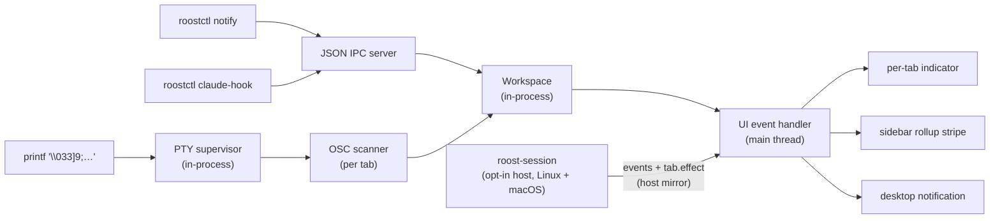

# Architecture

Roost ships one desktop UI, written in Rust with iced, on macOS (`Roost.app`) and Linux (`roost`, packaged as the `.deb`). It embeds its runtime in-process; the same binary builds for both host OSes, with the AppKit-only seams in `crates/roost-iced/src/macos/`. External tooling (the `roostctl` CLI, Claude Code hooks) talks to a running UI via newline-delimited JSON over a Unix-domain socket; the wire format is documented in [`docs/reference/ipc.md`](ipc.md). `libghostty-vt` is vendored once and linked directly into the UI for in-process VT parsing and rendering.

One contract, one desktop implementation: the op set in `roost-ipc` is the contract, and the Rust side implements it over the toolkit-neutral `roost-engine`. A mobile client of `roost-session` is planned.

For the durable design rationale (why in-process, why local UDS) see [Vision](../development/vision.md).

## Stack

| Layer | Implementation (`crates/roost-iced`, Rust + iced) |
|---|---|
| Window + chrome | Rust + iced (`crates/roost-iced/src/app.rs`) |
| Renderer | iced + wgpu over the libghostty-vt cell grid (`crates/roost-iced/src/terminal_widget.rs`) |
| Terminal engine | `libghostty-vt` (vendored, shared archive) |
| Workspace | `crates/roost-engine/src/workspace.rs` |
| PTY supervisor | `crates/roost-engine/src/pty.rs` (`portable-pty` + tokio tasks) |
| Persistence | `state.json` via tmp + fsync + rename + parent-dir fsync (`crates/roost-engine/src/persistence.rs`) |
| IPC server | `crates/roost-ipc/src/server.rs` (tokio `UnixListener`) |
| IPC wire types | `crates/roost-ipc/src/messages.rs` (serde) |
| OSC scanning | `roost-osc` crate + `crates/roost-engine/src/osc.rs` (`OscRouter`), per per-tab drain task |
| URL detection (clickable links) | `crates/roost-url` |
| Agent state model (shell/lifecycle/attention/ownership axes, `tab.state` derivation) | `crates/roost-ipc/src/agent.rs` |
| Agent adapters (Claude Code today) | `roostctl claude-hook` (binary from `crates/roost-cli`, links `crates/roost-agent`) |
| Single-instance (two flocks: socket/bind + state — see [Paths](paths.md#two-single-instance-locks)) | `crates/roost-engine/src/single_instance.rs` (`File::try_lock`) |
| Shell-integration CLI | `roostctl` (binary from `crates/roost-cli`) |

Below the toolkit line the UI sits on `roost-engine` (workspace, PTY, persistence, events, single-instance) and `roost-ui-model` (config, theme, keybinds, palette, providers, agent/notification projections) — crates that are deliberately toolkit-neutral, both because the same code serves iced on two host OSes and because a mobile client of `roost-session` is planned. See [Shared Rust engine](../development/shared-rust-engine.md).

## Repository layout

```text
crates/
  roost-ipc/              # JSON wire format, framing, client, server, paths, target picker
  roost-agent/            # Pure agent adapters (Claude Code today) — hook event JSON in,
                          # tab.agent_report params out; no I/O, no socket, no clap
  roost-engine/           # Toolkit-neutral workspace, PTY, persistence, events, IPC dispatch
  roost-ui-model/         # Toolkit-neutral config, theme, keybind, palette, provider, agent/notification projections
  roost-vt/               # libghostty-vt FFI wrapper (--features ffi)
  roost-osc/              # OSC scanner + state machine
  roost-url/              # Shared URL detection for clickable links
  roost-cli/              # roostctl binary
  roost-client/           # Host-session client core: state machine, mirror, reconnect, op queue, uploads
  roost-iced/             # iced UI — the .deb ships it as /usr/bin/roost, the DMG as Roost.app;
                          #   src/macos/ holds the AppKit seams for the Mac build
  roost-session/          # opt-in headless host-session daemon (roost-session binary);
                          #   Linux + macOS (bundled in Roost.app),
                          #   started with `roostctl session start`
mac/
  Resources/              # Info.plist.template, entitlements, AppIcon
  scripts/bundle-iced.sh  # cargo → Roost.app (production) or Roost-Iced.app (dev) + embedded roostctl + codesign
docs/
  reference/ipc.md        # JSON IPC wire spec — canonical
  archive/roost.proto     # Historical reference (the pre-M7 gRPC schema)
third_party/ghostty/      # Vendored libghostty-vt build
```

## Hot path

PTY bytes flow `kernel → master fd → in-process drain task → libghostty-vt vt_write → renderer`. Everything is in the same process; the IPC socket carries only control messages (`tab.open`, `tab.write`, `events.subscribe`, etc.) and event broadcasts. The renderer never sees the wire.



**The session/client edge is the one path that skips `Workspace`.** A `roost-session` a UI has connected to (host sessions, `docs/development/host-sessions.md`) is a *separate* in-process workspace running on another machine or process; its tabs never enter this UI's own `Workspace`. Instead `HostConn` mirrors that session's events straight into the UI event handler, so a host tab's bell, clipboard write (`tab.effect`), and attention notifications reach the same output surfaces a local tab's do: the notification inbox, the desktop banner, the sidebar's rows and dots, and the agents palette. Those surfaces are host-*aware* where identity matters — every row is keyed by `TabKey`, so a host tab and a local tab that share a number can never be confused, and the agents palette names the host in each row's context — and host-*blind* in what they render, since a remote row is drawn by the same widgets as a local one.

**A host's connection state is the client's own, and it is readable from outside.** `HostConnSet` (`crates/roost-iced/src/host_conn.rs`) holds each host's `HostConnState` on the main thread — one `HostEntry` per saved host, so a host's connection, retained rows, attempt generation, ssh transport, outage and bootstrap note are created and torn down in one place rather than six — `Disconnected` / `Connecting` / `Connected` / `Stopped` / `NeedsRestart` — and one reducer projects it twice: into the sidebar section's status band, and onto the wire as [`host.status`](ipc.md#host-registry-host), which reports the band's own `rollup` string rather than re-deriving it. That is what makes the state assertable without reading pixels or log lines; `roostctl host status` is the same read from a shell. The two failure shapes are deliberately different: a connection that *dropped* retries itself (a localhost backoff, or the SSH ladder's ten jittered rungs — while one of those rungs is armed the band can only show the countdown, so the classified cause rides beside it in `retry.reason`), while a `localhost` session that could not be *started* settles on the first attempt — a `reason` for the band, a `detail` naming what the launch ladder actually hit, and no retry armed, because nothing a retry can do will create that binary. See [Host sessions (development)](../development/host-sessions.md) for the state machine and the SSH transport it rides.

The wire surface is small enough to inspect by hand:

```bash
echo '{"id":"1","op":"identify","params":{}}' | nc -U ~/Library/Caches/Roost/roost.sock
```

## Threading

iced's winit event loop is single-threaded for its `update`/`view` cycle (and AppKit, under the macOS build, is single-threaded for UI work). Widget operations and `libghostty-vt` calls must run on that thread.

| Layer | Thread / actor |
|---|---|
| UI widgets, draw, input | Main thread only (the winit event-loop thread, driven from `update` / `view`) |
| `libghostty-vt` handle + `vt_write` | Main thread only, driven from `update` |
| PTY read (master fd) | Per-tab `tokio::spawn_blocking` read loop in `roost-engine` |
| PTY write | A per-tab ordered tokio task draining an input + resize command channel, so submission order is preserved |
| Engine → UI feed | Workspace events, PTY output and IPC requests land on **one** channel from background tokio tasks; a `Notify`-backed iced `Subscription` wakes `update` to drain it on the main thread (`crates/roost-iced/src/engine_feed.rs`) |
| OSC dispatch | Main thread (delivered through the engine feed) |
| IPC accept loop | tokio task — never blocks main |
| IPC handler dispatch | The handler hands each request to the engine feed and awaits a oneshot reply, so mutations happen on the main thread in FIFO order |
| `state.json` writes | Main thread (small; atomic via tmp + rename) |

The UI is therefore single-actor for state: every request is applied on the UI thread, and responses come back in completion order rather than request order.

The drain has one subtlety: the feed is batched (capped per wake), and a request that arrives in a batch which already carries pending workspace mutations forces a mid-drain reconcile first, so an IPC caller never observes state from before the mutations that preceded it on the same channel. The macOS-only AppKit ops in `crates/roost-iced/src/macos/` additionally require an `objc2::MainThreadMarker` and fail loudly rather than touch AppKit off-thread.

## Boundaries

- The UI process owns its workspace, PTY supervisor, and IPC server. There is no separate daemon by default — except a fresh install, which starts its local tabs on a `roost-session` it manages. The other opt-in exception is `roost-session` (`crates/roost-session/`), a headless daemon for host-sessions, started with `roostctl session start` (see [`ipc.md`](ipc.md#session-sockets)). State is in memory + the bundle-profile `state.json` file. A saved host's *connection* state is the running UI's alone — `state.json` persists only the `{id, label, target, last_connected}` registry, plus the tab the window last showed in each of a host's projects (`tab_memory`) — which is why `host.connect` / `host.disconnect` / `host.status` have no headless form and answer `internal: no UI attached` without one.
- `libghostty-vt` lives inside the UI for VT parsing + rendering.
- OSC scanning lives in the UI (the `roost-osc` crate + `roost-engine`'s `OscRouter`) because OSC parsing walks the same byte stream the VT parser does. OSC events apply directly to the local workspace.
- Terminal *query* replies (the program asking the terminal for its colors, device attributes, etc.) all come from libghostty, through the `write_pty` effects callback the UI installs and drains onto the tab's PTY input. Roost's OSC scanner sees those queries but answers none of them — it did synthesize the OSC color replies until the pinned SHA started answering them, at which point synthesizing too meant double-answering. See [Terminal query replies](terminal-queries.md).
- The IPC server is per-UI: external tooling (`roostctl`, Claude hooks) talks to the bundle profile's socket. Dev builds of iced (and the dev `Roost-Iced.app`) use isolated `Roost-iced`/`roost-iced` paths; the packaged `.deb` build resolves the production `Linux` profile and the shipped `Roost.app` the `Mac` profile instead (see [Paths & Environment](paths.md)). `roostctl --target {mac,linux,iced}` routes explicitly; with no selector it probes every distinct candidate concurrently and requires a choice if multiple UIs answer.
- Single-instance enforcement uses `flock(LOCK_EX | LOCK_NB)` on **two** lock files, one per thing guarded: `roost.lock` beside the socket (the bind lock, following the socket: `XDG_RUNTIME_DIR` for a UI, the passwd-home socket directory or `ROOST_SESSION_SOCKET_DIR` for a session) and `state.lock` beside `state.json` (following `ROOST_STATE_DIR`). They are taken socket-first and released in reverse. Losing the **socket** lock reads the holder PID, activates the running window and exits 0; losing the **state** lock **fails closed** — it guards `state.json`, and the owner's socket is undiscoverable in that case by construction. There is no bypass. See [Paths & Environment](paths.md).

See the [decision index](../development/vision.md#decision-log) and [Decision history](../development/decision-history.md) for the rationale behind each major choice.
